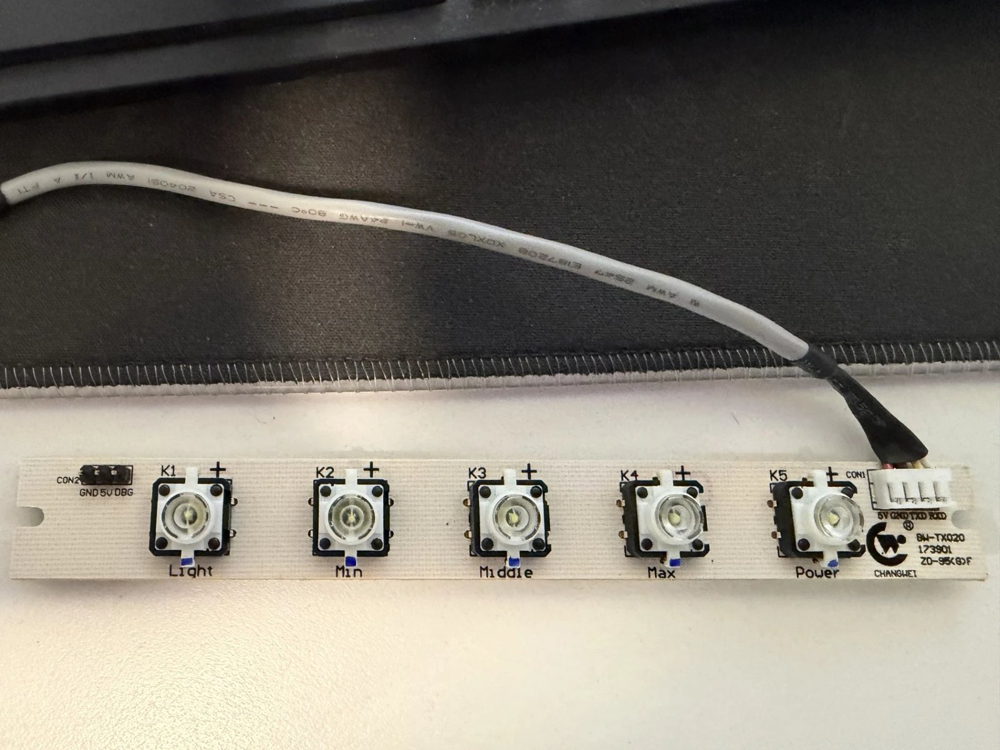
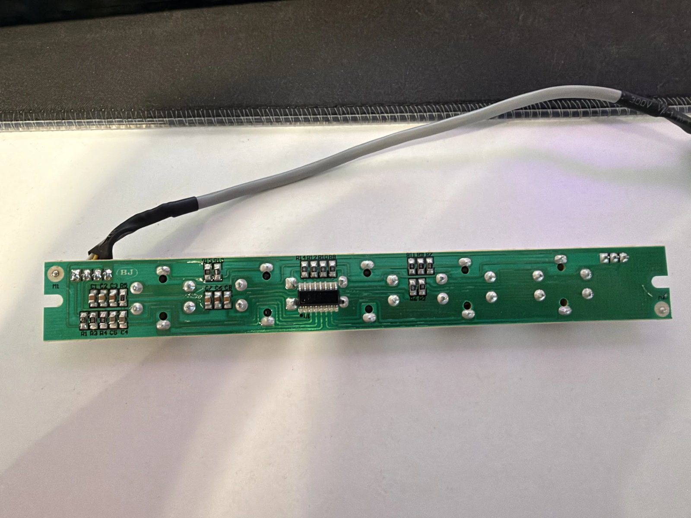
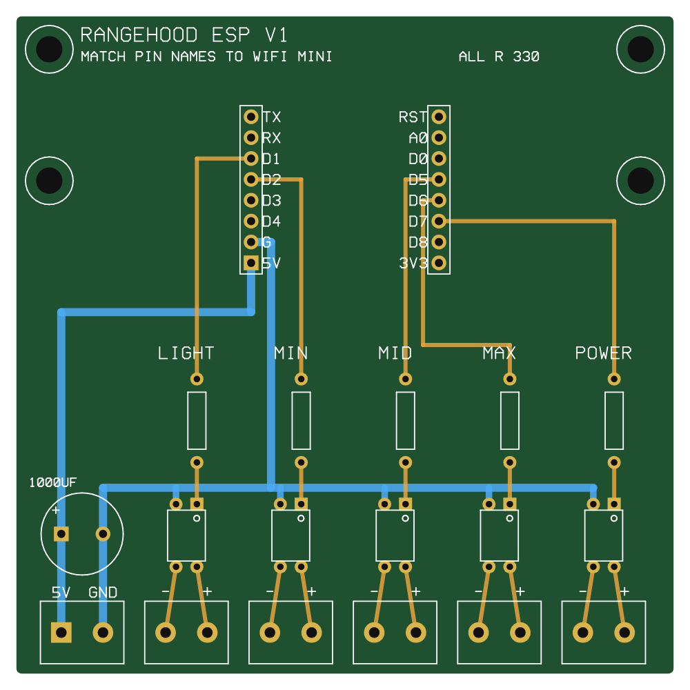
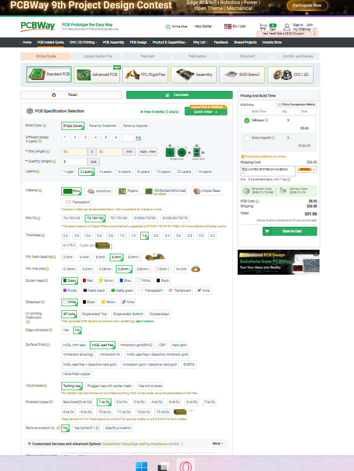
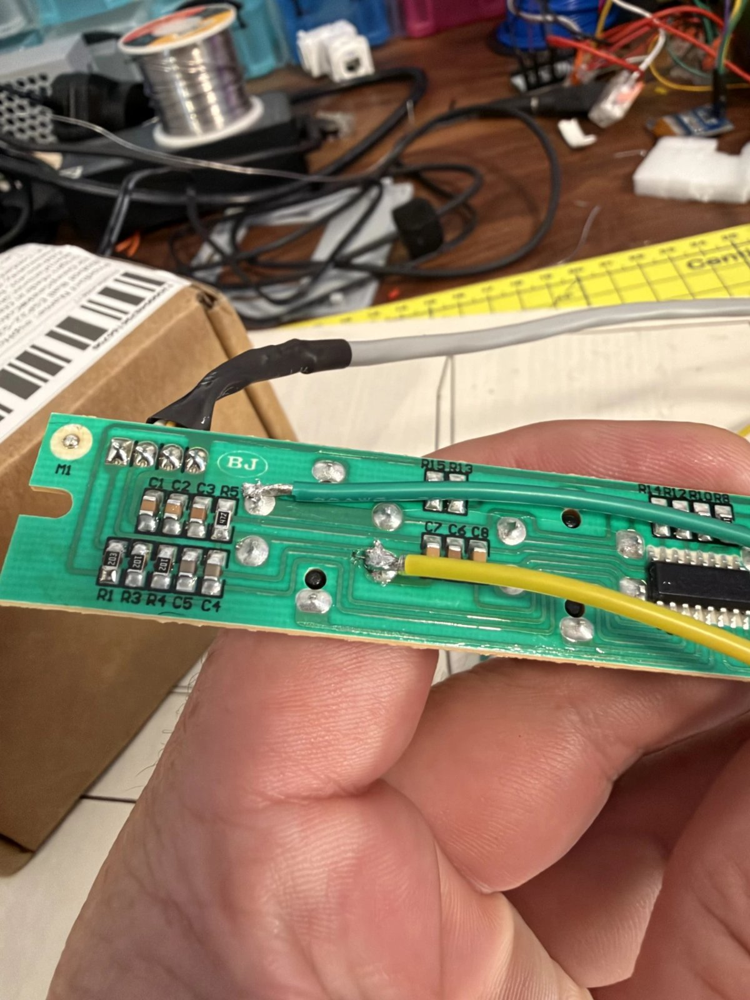
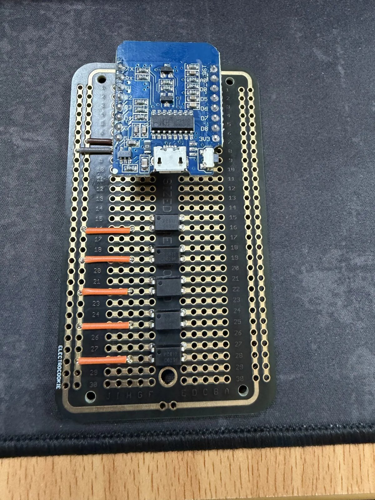
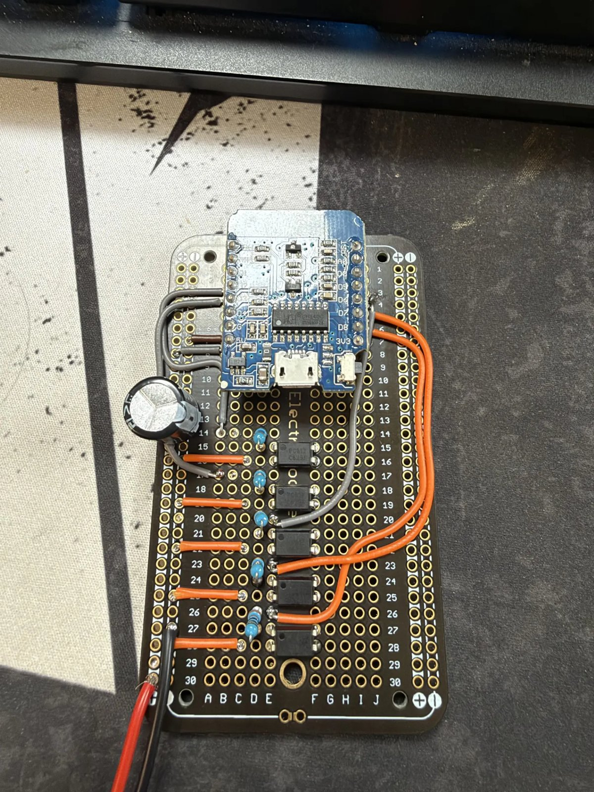
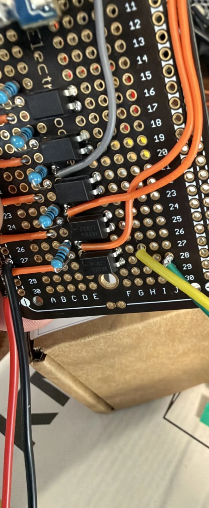

# Push-Button Rangehood → Home Assistant (ESPHome)

Control a **push-button rangehood** from **Home Assistant**. It was built and tested on a **Cardini RH9T340**, but the method works on **any rangehood with push buttons**. It does this using an ESP8266 (D1 mini) and five **PC817 optocouplers** that "press" the hood's own buttons. This repo includes:
- a custom PCB, ready to order
- a 3D-printable enclosure
- the ESPHome firmware
- everything we learned building it

You don't need to touch mains wiring, and the physical buttons keep working exactly as before.

```
Home Assistant ──Wi-Fi──► ESP8266 (D1 mini) ──► PC817 ──► across each hood button
```

In Home Assistant you get five buttons: **Light, Fan Min, Fan Middle, Fan Max and Power**.

| Hood button board (front) | Hood button board (back) |
|---|---|
|  |  |

---

## Contents
- [Safety](#safety)
- [Will it work on my hood?](#will-it-work-on-my-hood)
- [How it works](#how-it-works)
- [Parts list](#parts-list)
- [1. Order the PCB](#1-order-the-pcb)
- [2. Solder the PCB](#2-solder-the-pcb)
- [3. Flash the firmware](#3-flash-the-firmware)
- [4. Print the enclosure](#4-print-the-enclosure)
- [5. Wire it to the hood](#5-wire-it-to-the-hood)
- [Troubleshooting](#troubleshooting)
- [Lessons learned](#lessons-learned)
- [The prototype (no custom PCB)](#the-prototype-no-custom-pcb)
- [Repo layout](#repo-layout)

---

## Safety

- **Unplug the rangehood (or switch it off at the wall)** before opening it. The hood's main board has 240 V mains on it.
- This project connects **only to the low-voltage button board (5 V)**. Never probe or solder anything on the mains side.
- **Never connect USB to the ESP while it is wired to the hood.** Program it on the bench first.
- You do this at your own risk, and it will probably void your warranty.

---

## Will it work on my hood?

**Most likely, yes, if your hood has push buttons.** Every push button is just a switch that joins two points when pressed, and this project simply joins them electronically. Only the wiring points (step 5) change from hood to hood.

It was built on a **Cardini RH9T340** rangehood. Its button board is marked:
- **BW-TX020 / ZD-95(G)F** (made by Changwei)
- five buttons: **K1 Light, K2 Min, K3 Middle, K4 Max, K5 Power**, each with an LED
- connector **CON1** (5V, GND, TXD, RXD) to the hood's main board
- a 3-pin header **CON2** (GND, 5V, DBG)

If your board looks like the photos above, it should work as-is. On any other push-button hood, it works as long as:
1. you can find **5 V and GND** on the button board to power the ESP, and
2. each button is a simple switch that joins two points when pressed.

---

## How it works

Each button gets one optocoupler, wired like this:

```
ESP GPIO ──[330 Ω]──► PC817 pin 1 (LED +)
                      PC817 pin 2 (LED −) ──► GND

PC817 pin 4 (collector) ──► button leg at ~5 V   ("+" terminal on the PCB)
PC817 pin 3 (emitter)   ──► button leg at 0 V    ("−" terminal on the PCB)
```

When Home Assistant presses a button, the ESP turns its GPIO on for **200 ms**. The LED inside the PC817 lights, and its transistor joins the two button legs, exactly like a finger press. The ESP and the hood share 5 V and GND (the ESP is powered from the button board), so the PC817 here works as a clean electronic switch rather than as isolation.

| Hood button | ESP pin |
|---|---|
| Light | D1 |
| Fan Min | D2 |
| Fan Middle | D5 |
| Fan Max | D6 |
| Power | D7 |

D3, D4 and D8 are deliberately unused. They are ESP8266 boot-mode pins and can stop it booting.

---

## Parts list

| Qty | Part | Notes |
|---|---|---|
| 1 | Custom PCB (this repo) | 80 × 80 mm, 2-layer. Minimum order is usually 5. |
| 1 | ESP8266 D1 mini | We used a Duinotech "Wi-Fi Mini" (Jaycar XC3802). Any D1 mini clone works. |
| 2 | 8-pin female header, 2.54 mm | Lets you unplug the D1 mini for USB programming |
| 5 | PC817 optocoupler (DIP-4) | Usually sold in packs of 50 |
| 5 | 330 Ω resistor, 1/4 W | |
| 1 | 1000 µF electrolytic capacitor, 10–16 V | ≤ 10 mm diameter, 5 mm lead spacing. **Don't go smaller** (see [Lessons learned](#lessons-learned)). |
| 6 | 2-way screw terminal, 5.08 mm pitch | 5 buttons + power |
| — | Thin hook-up wire (about 26 AWG), two colours | From the hood button board to the terminals |
| 4 | M3 × 6–8 mm self-tapping screws | PCB to enclosure |
| 4 | M3 × 10–12 mm self-tapping screws | Enclosure lid |
| — | Flux, isopropyl alcohol | The hood board pads are coated and hard to solder without them |
| 1 | Micro-USB **data** cable | Charge-only cables can't program the ESP |

Tools: soldering iron, multimeter with continuity beep, side cutters, 3D printer (or a print service).

---

## 1. Order the PCB



1. Go to **[PCBWay](https://www.pcbway.com)** or **[JLCPCB](https://jlcpcb.com)** and start a standard PCB quote.
2. Upload **[`pcb/rangehood-esp-gerbers.zip`](pcb/rangehood-esp-gerbers.zip)**. Don't unzip it first.
3. Settings: **80 × 80 mm, 2 layers, 1.6 mm, quantity 5**. Leave everything else at the defaults: FR-4, HASL, 1 oz copper, any colour.
4. **Set the shipping country to your own.** PCBWay defaults to the USA.
5. You don't need assembly. Every part is through-hole and easy to solder.

<details><summary>Screenshot: PCBWay settings that worked</summary>



This screenshot still shows the default USA shipping. Change it to your country.
</details>

The board was generated by [`pcb/source/gen_pcb.py`](pcb/source/gen_pcb.py), a plain Python script with no CAD program needed. It also runs clearance and connectivity checks. To regenerate the files: `python gen_pcb.py out_dir`.

---

## 2. Solder the PCB

Solder the shortest parts first:

1. **Resistors (R)**: either way round.
2. **PC817s**: the dot on the chip goes next to the **square pad**, which also has a small printed circle beside it.
3. **Female headers**: plug the D1 mini in while soldering so they stay straight, then unplug it.
4. **1000 µF capacitor**: the **long leg goes in the square pad marked +**, and the striped side goes toward GND.
5. **Screw terminals**: the wire openings face the board edge.

**The D1 mini plugs in with its USB connector facing down toward the resistors.** Match the pin names printed on the D1 mini to the names on the PCB (5V next to 5V, TX next to TX, and so on).

**Before powering anything:** with the multimeter on continuity, the **5V and GND terminal pins must NOT beep** to each other.

---

## 3. Flash the firmware

Do this **on the bench over USB**, before the board goes anywhere near the hood.

1. Install the **ESPHome** add-on in Home Assistant, or the ESPHome desktop app.
2. Create a new device and paste in [`firmware/range-hood.yaml`](firmware/range-hood.yaml).
3. Create a `secrets.yaml` from [`firmware/secrets.example.yaml`](firmware/secrets.example.yaml) with your Wi-Fi details. **Never upload your real `secrets.yaml` anywhere.**
4. Plug the D1 mini into your computer with a **data** USB cable and choose **Install → Plug into this computer**, or use [web.esphome.io](https://web.esphome.io).
5. When it shows **Online**, add it in Home Assistant (**Settings → Devices & services**).

Once the board is running from a solid supply (this PCB with the 1000 µF capacitor), later updates over Wi-Fi work fine, even with it installed in the hood.

---

## 4. Print the enclosure

| File | Print orientation |
|---|---|
| [`enclosure/rangehood-box.stl`](enclosure/rangehood-box.stl) | Open side up |
| [`enclosure/rangehood-lid.stl`](enclosure/rangehood-lid.stl) | Flat, with the lip facing up |

- **Use PETG or ASA, not PLA.** It gets warm inside a rangehood and PLA can soften and warp.
- 0.2 mm layers, 3 walls, 20 % infill, **no supports**.
- Box: 86 × 86 × 34 mm, with corner screw posts and two side mounting ears (4.5 mm holes).
- The PCB screws onto 4 posts, 5 mm above the floor. The front wall has a slot lined up with the screw terminals for the hood wires.

The model is generated by [`enclosure/source/gen_enclosure.py`](enclosure/source/gen_enclosure.py), which needs `trimesh` and `manifold3d`.

---

## 5. Wire it to the hood



**Find the right points:**
- **Power:** use **CON2** on the button board: **GND** and **5V**. Connect them to the PCB's **GND** and **5V** terminal.
- **Buttons:** each tactile switch has 4 legs. The two legs that matter are on the **diagonal**. With the hood unplugged, use continuity mode to find the pair that beeps **only while the button is pressed**.
- **The back of the board is a mirror image of the front.** Seen from the back, the buttons run **Power, Max, Middle, Min, Light** from left to right.

**Get the polarity right.** The PC817 only switches one way. For each button:
1. Power the hood.
2. Put the multimeter's red probe on one leg and black on the other.
3. **About +5 V:** the red-probe leg goes to the **+** terminal.
4. **About −5 V:** swap them.
5. If a button doesn't respond later, swapping its two wires in the terminal is the first thing to try.

**Soldering to the hood board:** the pads have a coating that solder won't wet. Clean them with isopropyl alcohol, add flux, and **tin the wire and the pad separately** before joining them.

**Test one button at a time.** Wire one, test it from Home Assistant, then do the next. After the hood powers up, give the ESP **about a minute** to join Wi-Fi, because it's slow inside a metal hood.

---

## Troubleshooting

If you need to measure, uncomment the **debug "hold" switches** at the bottom of the YAML and flash it over USB. Each switch keeps one optocoupler ON so you can measure with a multimeter. Use **one measurement at a time**, with the black probe on GND:

| Probe point (hold switch ON) | Expect | If not |
|---|---|---|
| PC817 pin 2 | **0 V** | Bad ground connection |
| PC817 pin 1 | **about 1.1 V** | About 3.2 V means pin 2 isn't reaching ground. About 0 V means no signal from the ESP. |
| Resistor, ESP side | **about 3.2 V** | Bad signal joint or header contact |
| 5V terminal to GND | **about 4.8–5 V** | Anything lower means a bad power joint, or something pulling too much current |

| Symptom | Likely cause |
|---|---|
| Nothing works, multimeter reads about 0 V everywhere | Check the multimeter is on **DC volts** first |
| "No compatible devices" when flashing | Charge-only USB cable |
| Works for a few minutes, then buttons do nothing while HA still says online | ESP is dropping off Wi-Fi because of unstable power. Check the 5V/GND joints and the capacitor. |
| Hood LEDs dim when running on USB | Bad joint on the 5V/GND supply |
| Solid blue LED on the ESP, never connects | Corrupted firmware. Erase and reflash over USB: `esptool erase_flash`, then flash the factory .bin. |
| One button never works | Hood wires the wrong way round. Swap them in the terminal. |
| Hood's buttons stop responding until power-cycled | A button was held too long (the hood's own behaviour). Keep presses at 200 ms. |

---

## Lessons learned

The first version was hand-wired on a solderable breadboard, and nearly every fault came from that:

- **Bad solder joints were the #1 problem.** Several ground and power wire joints looked fine but were cracked or "cold". Results changed without anything being touched, and fixing one joint would disturb a neighbour. **Moving to a proper PCB fixed it completely.** It worked first time.
- **A wire can be broken inside its insulation.** If a signal never arrives, replace the wire.
- **Weak power breaks Wi-Fi updates.** With bad supply joints and only a 100 µF capacitor, a Wi-Fi (OTA) update inside the hood corrupted the firmware and needed a USB re-flash. With the PCB and a **1000 µF** capacitor, Wi-Fi updates in the hood are fine.
- **Wi-Fi inside a metal hood is slow to connect.** Be patient after power-up.
- **Don't hold Power.** Holding the hood's Power input for a few seconds locked up its button board until it was power-cycled.
- **Debug one measurement at a time.** Measuring several points at once made it easy to get confused.

---

## The prototype (no custom PCB)

If you'd rather not order PCBs, the same circuit fits on an **ElectroCookie half-size solderable breadboard**. The full layout is in [`docs/prototype-board-layout.html`](docs/prototype-board-layout.html) (open it in a browser). It works, but take extra care with every joint (see above).

| Early build | Finished prototype | Wired to the hood board |
|---|---|---|
|  |  |  |

---

## Repo layout

```
README.md
firmware/
  range-hood.yaml            ESPHome config
  secrets.example.yaml       copy to secrets.yaml and fill in
pcb/
  rangehood-esp-gerbers.zip  upload this to PCBWay / JLCPCB
  board-preview.png
  gerbers/                   the individual Gerber + drill files
  source/gen_pcb.py          script that generates the PCB
enclosure/
  rangehood-box.stl
  rangehood-lid.stl
  source/gen_enclosure.py    script that generates the enclosure
docs/
  images/                    build photos
  prototype-board-layout.html
```

## License

MIT. See [LICENSE](LICENSE).
